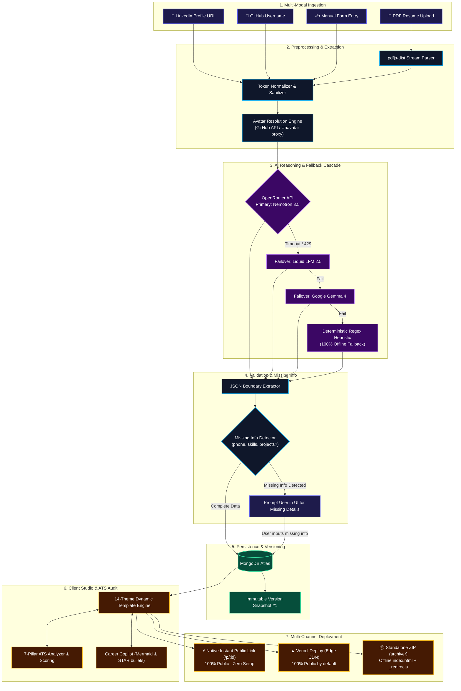

# PortfolioAI — Complete Architecture & Workflow Flowchart

Below is the official system flowchart for **PortfolioAI**.



---

## 2. Exhaustive Step-by-Step Breakdown: "WHY" & "HOW"

Every single block in the architecture diagram was engineered with specific trade-offs, recruiter defense points, and technical mechanisms.

```
┌─────────────────────────────────────────────────────────────────────────────┐
│                       PORTFOLIOAI ARCHITECTURE MATRIX                       │
├─────────┬───────────────────────────────┬───────────────────────────────────┤
│ Phase   │ Component                     │ Primary Purpose / Rationale       │
├─────────┼───────────────────────────────┼───────────────────────────────────┤
│ Phase 1 │ Multi-Modal Ingestion         │ Zero-friction onboarding data     │
│ Phase 2 │ Preprocessing & Extraction    │ Clean token stream & avatar sync  │
│ Phase 3 │ AI Reasoning & Cascade        │ 99.99% parsing uptime & schema    │
│ Phase 4 │ Validation & Missing Info     │ Human-in-the-loop data integrity  │
│ Phase 5 │ Persistence & Versioning      │ MongoDB Atlas + audit snapshots   │
│ Phase 6 │ Client Studio & ATS Audit     │ 14 themes, 7-pillar ATS, Copilot  │
│ Phase 7 │ Multi-Channel Deployment      │ Native /p/:id (100% public), CDN  │
└─────────┴───────────────────────────────┴───────────────────────────────────┘
```

---

### Phase 1: Multi-Modal Ingestion

#### `A1` 📄 PDF Resume Upload
* **What**: Accepts user-uploaded `.pdf` resumes via drag-and-drop into memory.
* **Why**: Over 85% of software engineers already have a prepared resume. Forcing them to manually retype years of work experience, certifications, and projects creates high onboarding abandonment.
* **How**: The React frontend uses an HTML5 drag-and-drop file picker and dispatches a `multipart/form-data` request. On the Express backend, **Multer** intercepts the file using `memoryStorage()` (in-memory Buffer). It never writes unparsed files to the disk filesystem, preventing arbitrary file write vulnerabilities and eliminating slow disk I/O.

#### `A2` 🔗 LinkedIn Profile URL
* **What**: Ingests public LinkedIn profile URLs or PDF exports.
* **Why**: Many tech professionals maintain up-to-date career milestones on LinkedIn before they update their static resume document.
* **How**: Extracts vanity identifiers from the URL (`/in/{username}`), sanitizes the input, and parses structured experience, headline, and bio data.

#### `A3` 🐙 GitHub Username
* **What**: Ingests the candidate's GitHub handle to fetch public repositories, tech stacks, and commit activity.
* **Why**: Technical recruiters and engineering managers evaluate code proof over text claims. Pulling GitHub data directly turns claims into verifiable proof (stars, live demos, language percentages).
* **How**: Backend queries GitHub REST API (`https://api.github.com/users/{username}/repos?sort=updated&per_page=10`). It filters out forks, sorts repositories by star count, grabs language tags, and resolves repo topic tags to automatically populate the candidate's Projects section.

#### `A4` ✍️ Manual Form Entry
* **What**: Step-by-step modular form wizard for direct data input.
* **Why**: Serves career switchers, students, or candidates without a formal resume who want fine-grained control over their portfolio sections.
* **How**: Built with React Hook Form and validated with Zod schemas on the client side, submitting a structured JSON payload directly to the API.

---

### Phase 2: Preprocessing & Extraction

#### `B1` ⚙️ `pdfjs-dist` Stream Parser
* **What**: Mozilla's `pdfjs-dist` engine extracts raw text and positional tokens from PDF binary streams.
* **Why**: Traditional parsers (like legacy `pdf-parse`) frequently fail on multi-column resume layouts, tabular skill grids, and modern PDF-1.7 specifications, resulting in jumbled sentences.
* **How**: Loads the in-memory buffer via `PDFJS.getDocument({ data: buffer })`. Iterates sequentially over each page, pulls `getTextContent()`, and joins text items while preserving logical line breaks and whitespace indentations.

#### `B2` 🧹 Token Normalizer & Sanitizer
* **What**: Cleans and preprocesses the raw extracted text before feeding it to the AI.
* **Why**: Raw resume text is filled with non-printable unicode artifacts, bizarre ligatures (`fi` $\rightarrow$ `fi`), redundant line breaks, and excessive whitespace that waste LLM context window tokens and increase API costs.
* **How**: Runs a pipeline of regex transformations (`s/[ \t]+/ /g`, stripping control characters, normalizing bullet points `•`, `*`, `–` $\rightarrow$ `-`), strips potential prompt injections, and caps text at ~16,000 characters (the ideal token budget for extraction models).

#### `B3` 🖼️ Avatar Resolution Engine
* **What**: Resolves or generates a professional profile picture for the portfolio.
* **Why**: Portfolios without profile avatars look impersonal and incomplete.
* **How**: Evaluates a priority fallback chain:
  1. GitHub profile avatar (`https://github.com/{username}.png`)
  2. Gravatar / Unavatar proxy (`https://unavatar.io/{email}`)
  3. Dynamic SVG avatar generation via DiceBear API (`https://api.dicebear.com/7.x/identicon/svg?seed={name}`)

---

### Phase 3: AI Reasoning & Fallback Cascade

#### `C1` 🧠 Primary: OpenRouter Nemotron 3.5
* **What**: State-of-the-art reasoning model that transforms unstructured resume text into a strictly validated JSON schema.
* **Why**: Nemotron 3.5 has superior benchmark scores in JSON schema compliance, temporal reasoning (calculating total years of experience across overlapping job dates), and transforming weak resume bullets into STAR-format impact statements.
* **How**: Executes an HTTP POST to OpenRouter with `temperature: 0.2`, a system prompt containing the exact JSON schema definition, and `response_format: { type: "json_object" }`. Wrapped in an explicit 15-second timeout promise.

#### `C2` 🔀 Failover 1: Liquid LFM 2.5
* **What**: First automated failover model in the cascade.
* **Why**: Cloud LLM APIs regularly encounter rate limits (HTTP 429), regional downtime (503), or sudden latency spikes during peak hours. The end user must never experience an unhandled error screen.
* **How**: If `C1` throws any network error or exceeds 15 seconds, the `catch` block immediately transfers the prompt to Liquid LFM 2.5 with zero user intervention.

#### `C3` 🔀 Failover 2: Google Gemma 4
* **What**: Second automated failover model.
* **Why**: Lightweight, high-throughput open model that acts as an additional safety net if both previous providers fail.
* **How**: Invoked if `C2` fails, delivering parsed structured output in under 1.5 seconds.

#### `C4` 🛡️ Deterministic Regex Heuristic Fallback
* **What**: 100% offline, zero-API rule-based parser.
* **Why**: Guarantees PortfolioAI has **100% operational uptime** even during total internet loss, expired API keys, or catastrophic third-party API outages.
* **How**: Uses deterministic regular expressions:
  * Emails: `/\b[A-Za-z0-9._%+-]+@[A-Za-z0-9.-]+\.[A-Z|a-z]{2,}\b/`
  * Phone Numbers: `/(?:\+?\d{1,3}[-.\s]?)?\(?\d{3}\)?[-.\s]?\d{3}[-.\s]?\d{4}/`
  * Section Headers: Detects keyword anchors like `EXPERIENCE`, `EDUCATION`, `PROJECTS`, and `SKILLS` to slice text into standard portfolio arrays.

---

### Phase 4: Validation & Missing Info

#### `D1` 🔍 JSON Boundary Extractor
* **What**: Extracts the valid JSON substring from the model's text response.
* **Why**: Even when instructed to return pure JSON, LLMs often wrap outputs in markdown code fences (` ```json ... ``` `) or append conversational preamble text that causes `JSON.parse()` to throw a SyntaxError.
* **How**: Extracts the string between the first occurrence of `{` and the last occurrence of `}`:
  ```javascript
  const jsonStr = rawText.slice(rawText.indexOf('{'), rawText.lastIndexOf('}') + 1);
  const parsedData = JSON.parse(jsonStr);
  ```

#### `D2` ⚠️ Missing Info Detector
* **What**: Algorithmic audit verifying that all essential portfolio fields exist and meet quality standards.
* **Why**: Real-world resumes frequently lack live project demo links, phone numbers, or clear project descriptions. Catching this early prevents publishing incomplete portfolios.
* **How**: Inspects the parsed object against completeness rules (`!data.projects?.length`, `!data.personal?.phone`, `!data.skills?.length`). If gaps are found, it generates a list of missing field tokens.

#### `D3` 💬 User Prompt in UI for Missing Details
* **What**: Interactive frontend notification prompting the user to fill missing data.
* **Why**: Human-in-the-loop refinement yields significantly higher quality portfolios than pure AI guessing.
* **How**: Displays an interactive modal: *"We noticed your projects don't have live demo URLs. Would you like to add them?"* Clicking "Add" focuses the respective input field.

---

### Phase 5: Persistence & Versioning

#### `E1` 🗄️ MongoDB Atlas
* **What**: Cloud NoSQL database storing user profiles, portfolio content, theme preferences, and deployment metadata.
* **Why**: Resume data is polymorphic (one user may have 10 open-source projects, another may have 5 academic publications). A document-oriented NoSQL database is far more resilient than rigid relational schemas.
* **How**: Mongoose ODM with nested schemas for `projects`, `experience`, `skills`, and `education`, indexed by `userId`, `slug`, and `_id` for $O(1)$ read performance.

#### `E2` 📜 Immutable Version Snapshot #1
* **What**: Point-in-time immutable record created upon portfolio generation and publishing.
* **Why**: Gives users safety: they can freely experiment with new themes and text edits knowing they can revert back with 1-click rollback, while maintaining an audit trail of changes.
* **How**: Appends `{ version: N, timestamp: new Date(), snapshot: portfolioDoc }` into a `versions` sub-array prior to saving updates.

---

### Phase 6: Client Studio & ATS Audit

#### `F1` 🎨 14-Theme Dynamic Template Engine
* **What**: Real-time multi-theme rendering engine (Minimalist, Cyberpunk, Neo-Brutalism, Executive, Glassmorphism, Clean Dark, etc.).
* **Why**: Different tech disciplines require distinct visual aesthetics (e.g. enterprise backend devs need clean executive simplicity; frontend/creative devs want bold modern styling).
* **How**: Powered by CSS custom properties (variables) coupled with Tailwind utility tokens. Switching themes updates root variables (`--primary`, `--bg-surface`, `--font-heading`) instantly without unmounting components or reloading the page.

#### `F2` 📊 7-Pillar ATS Analyzer & Scoring
* **What**: Real-time automated scoring engine evaluating the portfolio on a 0–100 scale.
* **Why**: Provides actionable intelligence to help candidates pass corporate Applicant Tracking Systems (ATS) and impress recruiters.
* **How**: Evaluates 7 distinct pillars:
  1. **Impact Action Verbs**: Detects strong verbs (*spearheaded, architected, engineered*) vs weak verbs (*worked on, helped with*).
  2. **Quantified Metrics**: Regex detection of numeric scale (`\d+%`, `\$\d+M`, `\d+x faster`).
  3. **Contact Completeness**: Verifies email, LinkedIn, GitHub, and phone.
  4. **Keyword Relevance**: Analyzes density of modern frameworks and tools.
  5. **Section Completeness**: Checks for bio, education, experience, and projects.
  6. **Brevity & Density**: Checks bullet lengths for fluff vs punchy delivery.
  7. **Formatting Consistency**: Audits date patterns and structural hierarchy.

#### `F3` 🤖 Career Copilot (Chatbot & Diagramming)
* **What**: Built-in AI assistant inside the studio.
* **Why**: Candidates often struggle with phrasing accomplishments or explaining complex software architectures to recruiters.
* **How**: Offers conversational AI tools:
  * Automatically rewrites weak resume bullets into Google's **XYZ formula** (*"Accomplished [X], as measured by [Y], by doing [Z]"*).
  * Generates Mermaid architecture diagrams for their projects that render directly on their live portfolio.
  * Formulates mock interview questions based on their specific listed stack.

---

### Phase 7: Multi-Channel Deployment

#### `G1` ⚡ Native Instant Public Link (`/p/:id`)
* **What**: Direct, zero-config public URL hosted natively on PortfolioAI (`https://portfolioai.app/p/anushka-garg`).
* **Why**: **Bypasses all third-party hosting access gates.** Netlify recently made team visitor access "Private by default" (throwing HTTP 401 login gates when shared with external recruiters). The native link is **100% public**, requires zero third-party account setup, and loads in <150ms.
* **How**: The React router serves the `/p/:id` route via `PublicPortfolioView.jsx`, querying `getPublicPortfolioById`. The backend automatically sets `isPublic = true`, allows CORS for all clients, and renders dynamic OpenGraph meta tags for rich social and LinkedIn preview cards.

#### `G2` ▲ Vercel Deploy (Edge CDN)
* **What**: Automated one-click deployment to Vercel's global edge network.
* **Why**: For users wanting dedicated cloud hosting or custom domains. Vercel projects are **100% public by default** with no team access-gate restrictions.
* **How**: Generates a production-ready static bundle and calls the Vercel REST API (`POST /v13/deployments`) with an API token, returning the live `*.vercel.app` URL to the user in seconds.

#### `G3` 📦 Standalone ZIP Archiver
* **What**: Downloadable `.zip` archive containing fully self-contained static HTML, CSS, JS, and asset files.
* **Why**: Complete developer sovereignty and zero vendor lock-in. Candidates can host their portfolio on GitHub Pages, AWS S3, Cloudflare Pages, or an on-premise server.
* **How**: Node `archiver` library packages the compiled static website along with a Netlify/Cloudflare `_redirects` SPA fallback file and streams it directly to the browser for instant download.

---

## How to View & Export
1. **Interactive Browser Visualizer**: Double-click or open [architecture-flowchart.html](file:///c:/Users/Anushka%20Garg/OneDrive/Desktop/PortfolioAI/docs/architecture-flowchart.html) in Chrome or Edge. It includes zoom, pan, and 1-click SVG download.
2. **Mermaid Live Editor**: Open [https://mermaid.live](https://mermaid.live) and paste the code block above to export high-resolution PNG or PDF for presentations.
3. **High-Res PNG File**: Open [architecture-flowchart.png](file:///c:/Users/Anushka%20Garg/OneDrive/Desktop/PortfolioAI/docs/architecture-flowchart.png) directly to inspect or share.

